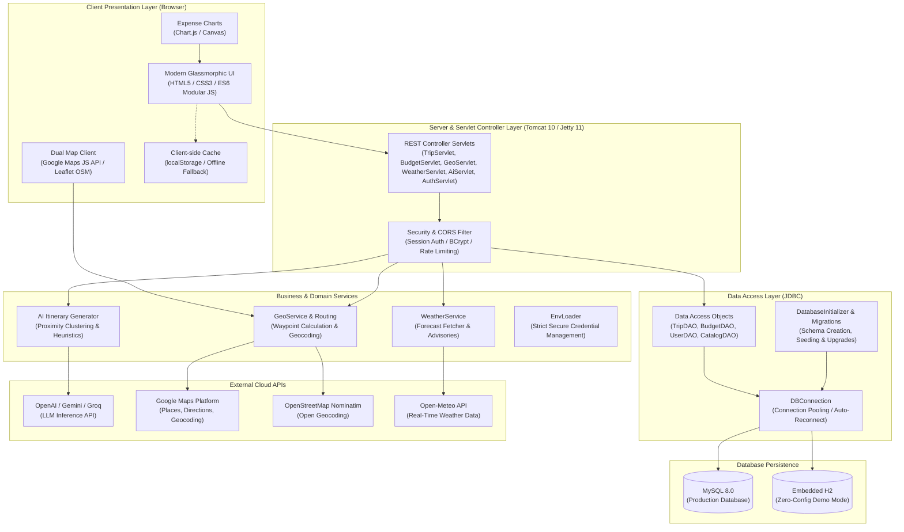

# 🌍 TravelMate — Intelligent AI Travel Planning & Workspace

<p align="center">
  
  
  
  
  
  
  
  
</p>

<p align="center">
  <strong>An end-to-end, AI-powered travel planning companion that replaces scattered spreadsheets, 20+ open browser tabs, and unrealistic itineraries with smart proximity-aware scheduling, live multi-modal transit comparison, dual-engine interactive maps, real-time weather intelligence, and dynamic budget analytics.</strong>
</p>

<p align="center">
  <a href="#-quick-start">🚀 Quick Start</a> •
  <a href="#-the-problem--our-solution">💡 The Solution</a> •
  <a href="#-key-features">✨ Key Features</a> •
  <a href="#-system-architecture">🏛️ Architecture</a> •
  <a href="#-tech-stack">💻 Tech Stack</a> •
  <a href="#-rest-api-reference">🌐 REST API</a> •
  <a href="#-testing--verification">🧪 Tests</a> •
  <a href="#-team--acknowledgments">👥 Team</a>
</p>

---

## 💡 The Problem & Our Solution

### The Fragmented Travel Dilemma
Planning a trip today is chaotic and frustrating:
- **Tab Overload:** Travelers juggle 15–20 browser tabs across flight search engines, IRCTC train portals, hotel booking platforms, Reddit travel threads, Google Maps, and messy budget spreadsheets.
- **The "Zigzag" Itinerary Problem:** Generic AI chatbots (ChatGPT, Gemini) produce generic bulleted lists with zero geographic awareness—scheduling an attraction in North Delhi at 10 AM, a restaurant in South Delhi at 1 PM (25 km away in peak traffic!), and an evening monument back up North.
- **Static & Inflexible:** Once drafted, changes require manually recalculating budgets, transit times, and distances.
- **Weather Blindness:** Travelers arrive at outdoor attractions during unexpected torrential downpours or extreme heat waves without prior warning.

### The TravelMate Solution
**TravelMate** unifies every stage of journey planning into a single, cohesive, interactive workspace:

| Challenge | Traditional Approach | The TravelMate Innovation |
| :--- | :--- | :--- |
| **Itinerary Generation** | Generic AI lists with 20+ km zigzag travel | **Proximity-Aware Clustering Engine:** Automatically groups attractions, hotels, and dining within tight geographical radii per day. |
| **Mapping & Places** | Switching back and forth to Google Maps | **Dual-Engine Interactive Workspace:** Built-in Google Maps Platform + OpenStreetMap fallback with 1-click place addition, opening hours, and phone numbers. |
| **Transit Planning** | Separate flight, train, bus, and taxi tabs | **Multi-Modal Route Hub:** Live comparisons between Flights, Indian Railways (IRCTC), Interstate Buses (RedBus), and driving routes with interactive route polylines. |
| **Financial Tracking** | Messy notes or post-trip spreadsheets | **Real-Time Dynamic Budgeting:** Categorized expenses (Stay, Travel, Food, Activities) with visual analytics and overspend alerts. |
| **Weather Disruptions** | Separate weather app lookups | **Live Weather Intelligence:** Real-time 7-day forecasts via Open-Meteo with proactive heuristic advisories and packing tips. |
| **Collaboration** | Screenshotting itineraries to friends | **Centralized Shared Workspace:** Sync trips across multiple travelers, duplicate itineraries, and access plans anywhere. |

---

## ✨ Key Features

### 🤖 1. Smart Proximity-Aware AI Itinerary Planner
- **Geographic Proximity Clustering:** Solves the common LLM flaw by grouping morning, lunch, afternoon, and evening stops geographically around your chosen hotel.
- **Intelligent Pacing:** Balances high-energy sightseeing with authentic dining recommendations and rest periods.
- **Universal LLM Compatibility:** Works out-of-the-box with any OpenAI-compatible API: **Google Gemini**, **OpenAI (GPT-4o/mini)**, **Groq (Llama 3)**, **OpenRouter**, **Mistral**, or local offline models via **Ollama**.
- **Self-Repairing JSON Parser:** Employs a resilient parser that automatically repairs partial or truncated model completions and ensures guaranteed itinerary generation.

### 🗺️ 2. Dual-Engine Interactive Mapping & Workspace
- **Google Maps Platform Integration:** Places Autocomplete, Geocoding, Directions API, and Street View.
- **Automatic OpenStreetMap Fallback:** Gracefully switches to Leaflet + Nominatim if no Google Maps API key is configured or when offline.
- **1-Click Place Addition:** Search any landmark or click directly on the map to inspect opening hours, website, phone number, and address, then add it straight to your itinerary.

### 🚆 3. Multi-Modal Transit & Intercity Routing
- **Side-by-Side Comparison:** Instantly compare travel times, fares, and carbon footprints across **Flights**, **Trains (IRCTC)**, **Buses (RedBus)**, and **Self-Drive / Cabs**.
- **Interactive Route Polylines:** Visualizes waypoint-to-waypoint driving and transit routes directly on the live map.
- **Direct Booking Integration:** Fast one-click links to official booking portals (MakeMyTrip, IRCTC, RedBus, Google Flights).

### 💰 4. Dynamic Budget Tracker & Visual Analytics
- **Multi-Category Tracking:** Track every rupee or dollar across **Accommodation**, **Transportation**, **Dining & Food**, **Activities & Tickets**, and **Miscellaneous**.
- **Real-Time Visual Breakdown:** Interactive donut charts and progress meters powered by Chart.js showing target budget vs. actual spend.
- **Overspend Warning Engine:** Proactively flags categories exceeding planned expenditure thresholds.

### ☀️ 5. Real-Time Weather Intelligence & Advisories
- **Live 7-Day Forecast:** Accurate temperature, precipitation probability, humidity, and wind speeds powered by the Open-Meteo API.
- **Heuristic Travel Advisories:** Context-aware recommendations (e.g., *"High probability of rain this afternoon — schedule indoor museum visits and carry an umbrella"*).
- **Automated Packing Recommendations:** Dynamically suggests wardrobe essentials based on destination climate.

### 🏛️ 6. Curated Indian Destinations Explorer
- Rich catalog covering top Indian travel destinations (Delhi, Jaipur, Agra, Mumbai, Goa, Kerala, Varanasi, and more).
- Filterable by interest tags: **Heritage & Monuments**, **Culture & Arts**, **Nature & Wildlife**, **Food & Nightlife**, and **Spiritual & Temples**.

### ⚡ 7. Zero-Setup Embedded Mode + Enterprise MySQL
- **60-Second Evaluation Mode:** Run the entire application with an embedded H2 database (`mvn -Ph2 jetty:run`) — zero installation of MySQL or external servers required!
- **Production MySQL 8.0 Architecture:** Fully supports enterprise MySQL with connection pooling, transactional integrity, and automated schema migrations.

### 🔒 8. Security & Offline Resilience
- **Zero Leaked Credentials:** Strict environment variable and `.env` loading (`TM_GOOGLE_MAPS_KEY`, `TM_AI_API_KEY`, `TM_DB_*`).
- **SQL Injection Prevention:** 100% parameterized JDBC `PreparedStatement` queries.
- **BCrypt Password Hashing:** Secure authentication with session cookie management.
- **Offline Fallback:** Automatically caches itineraries in browser `localStorage` so travelers retain offline access even with weak network connectivity.

---

## 🏛️ System Architecture



---

## 💻 Tech Stack

| Layer | Technologies & Libraries |
| :--- | :--- |
| **Frontend** | Semantic HTML5, Modern CSS3 (Glassmorphism, CSS Custom Properties, Flexbox/Grid), Vanilla ES6+ JavaScript (zero framework bloat, fast load times) |
| **Mapping & Geospatial** | Google Maps JavaScript API (Places Autocomplete, Directions, Street View) + Leaflet.js (OpenStreetMap Nominatim fallback) |
| **Data Visualization** | Chart.js (Budget breakdown charts, category spend distributions) |
| **Backend Framework** | Java 17 LTS, Jakarta EE 9+ / Jakarta Servlet 5.0, Apache Tomcat 10.1+ / Eclipse Jetty 11 |
| **Database & Persistence** | MySQL 8.0 (Production) + H2 Database 2.2 (Zero-setup embedded mode), Raw JDBC with PreparedStatements and HikariCP connection resilience |
| **AI & LLM Integration** | OpenAI-compatible Chat Completions API (Google Gemini, OpenAI GPT-4o, Groq, OpenRouter, Mistral, Ollama) |
| **External APIs** | Google Maps Platform, Open-Meteo Weather API, OpenStreetMap Nominatim |
| **Build & DevOps** | Apache Maven 3.9+ (with Maven Wrapper `mvnw`), Docker (Multi-stage build), Docker Compose, Render Cloud |
| **Testing & Quality** | JUnit 5, Automated integration test suite (200 test cases with 100% pass rate) |

---

## 📂 Project Directory Structure

```text
Travel__Mate/
├── .github/                      # CI/CD Workflows
├── src/
│   ├── main/
│   │   ├── java/com/travelmate/
│   │   │   ├── ai/               # AI Itinerary generation, JSON repair, prompt templates
│   │   │   ├── dao/              # JDBC Data Access Objects (Trip, Budget, User, Catalog)
│   │   │   ├── db/               # DBConnection, DatabaseInitializer, Schema migrations
│   │   │   ├── geo/              # GeoService, GoogleMapsClient, Nominatim OSM client
│   │   │   ├── model/            # Domain entities (Trip, Day, Stop, Budget, Expense, User)
│   │   │   ├── servlet/          # REST Servlets (Trip, Budget, Geo, Weather, AI, Auth)
│   │   │   ├── util/             # EnvLoader, JsonUtil, Security hashing utilities
│   │   │   └── weather/          # WeatherService, WeatherHeuristics, Open-Meteo client
│   │   ├── resources/
│   │   │   ├── ai.properties     # Default AI configuration & allowed emails
│   │   │   ├── db.properties     # Database connection defaults
│   │   │   ├── schema.sql        # MySQL/H2 table schema definition
│   │   │   ├── catalog-data.json # Curated destinations, monuments, and transport seed
│   │   │   └── seed-data.json    # Initial sample trips and budget entries
│   │   └── webapp/
│   │       ├── css/              # Modern stylesheets (travelmate.css)
│   │       ├── js/               # Frontend modules (store.js, map-provider.js, transport.js)
│   │       ├── index.html        # Landing page & destination highlights
│   │       ├── plan.html         # Interactive AI Trip Generator
│   │       ├── workspace.html    # Drag-and-drop Itinerary Planner & Map
│   │       ├── transport.html    # Multi-modal intercity transit hub
│   │       ├── budget.html       # Budget tracker & category spend analytics
│   │       ├── weather.html      # Real-time destination weather & packing advisory
│   │       ├── explore.html      # Indian tourism catalog & guides
│   │       ├── trips.html        # Saved trips & collaborative manager
│   │       ├── auth.html         # User sign-in / registration
│   │       └── settings.html     # AI provider configuration dashboard
│   └── test/java/com/travelmate/ # 200 automated JUnit tests
├── .env.example                  # Template for environment variables
├── Dockerfile                    # Multi-stage production container build
├── docker-compose.yml            # One-click full stack deployment (App + MySQL)
├── pom.xml                       # Maven build configuration
└── README.md                     # Project documentation
```

---

## 🚀 Quick Start Guide

### Prerequisites
- **Java Development Kit (JDK) 17 or higher** (`java -version`)
- **Git** (`git --version`)
- *(Optional)* MySQL 8.0 (only required if not using the embedded H2 mode)
- *(Optional)* Docker & Docker Compose

---

### ⚡ Option 1: The 60-Second Demo (Zero Configuration — Recommended!)
Experience the full application immediately without installing MySQL or configuring external databases:

```bash
# 1. Clone the repository
git clone https://github.com/purnaganesh2007-prog/Travel__Mate.git
cd Travel__Mate

# 2. Run with the embedded H2 database (Linux / macOS)
./mvnw -Ph2 jetty:run

# Or on Windows PowerShell:
.\mvnw.cmd -Ph2 jetty:run
```

Once started, open your browser and navigate to:
👉 **[http://localhost:8080/travelmate/](http://localhost:8080/travelmate/)**

*(Database schema, catalog destinations, and sample trips are initialized automatically on startup!)*

---

### 🛠️ Option 2: Full Setup with MySQL 8.0

1. **Start MySQL 8.0** and create a user or use existing credentials.
2. **Configure your credentials:**
   Create a `.env` file in the project root (or edit `src/main/resources/db.properties`):
   ```properties
   TM_DB_URL=jdbc:mysql://localhost:3306/tripmate?createDatabaseIfNotExist=true&useSSL=false&allowPublicKeyRetrieval=true&serverTimezone=UTC&characterEncoding=UTF-8
   TM_DB_USER=root
   TM_DB_PASSWORD=your_mysql_password
   ```
3. **Launch the application:**
   ```bash
   # Linux / macOS
   ./mvnw jetty:run

   # Windows PowerShell
   .\mvnw.cmd jetty:run
   ```
4. Verify the connection at:
   👉 **[http://localhost:8080/travelmate/api/health](http://localhost:8080/travelmate/api/health)** (Reports `"database": "up"`)

---

### 🐳 Option 3: Docker & Docker Compose

Run the entire stack (Tomcat 10.1 Web App + MySQL 8.0 container) with a single command:

```bash
docker compose up --build
```
The application will be accessible at:
👉 **[http://localhost:8080/travelmate/](http://localhost:8080/travelmate/)**

---

### 🔑 Default Demo Account

For quick evaluation, the application comes seeded with a pre-configured traveler account:
- **Email:** `demo.traveler@travelmate.in`
- **Password:** `demo12345`

---

## ⚙️ Configuration & Environment Variables

TravelMate uses a secure 3-tier precedence hierarchy: **System Properties > Environment Variables (`.env`) > Properties Files**.

| Variable | Required? | Default | Description |
| :--- | :---: | :--- | :--- |
| `TM_DB_URL` | Optional | `jdbc:mysql://localhost:3306/tripmate...` | JDBC connection URL for MySQL |
| `TM_DB_USER` | Optional | `root` | Database username |
| `TM_DB_PASSWORD` | Optional | *(empty)* | Database password |
| `TM_GOOGLE_MAPS_KEY` | Optional | *(null — falls back to OSM)* | Google Maps API key (Places, Geocoding, Directions) |
| `TM_GOOGLE_MAPS_BROWSER_KEY` | Optional | Same as server key | Restricted Google Maps key for client-side map rendering |
| `TM_AI_ENABLED` | Optional | `true` | Toggle AI trip itinerary generation |
| `TM_AI_BASE_URL` | Optional | `https://openrouter.ai/api/v1` | Base URL for OpenAI-compatible LLM endpoint |
| `TM_AI_MODEL` | Optional | `google/gemini-2.5-flash` | Model ID used for itinerary planning |
| `TM_AI_API_KEY` | Optional | *(empty)* | API key for LLM provider |
| `TM_AI_ALLOWED_EMAILS` | Optional | `demo.traveler@travelmate.in` | Comma-separated list of emails permitted to modify AI settings |
| `PORT` | Optional | `8080` | HTTP port for server binding |

---

## 🌐 REST API Reference

TravelMate provides a clean, decoupled RESTful JSON API:

### 🗺️ Trips & Itineraries
| Method | Endpoint | Description |
| :--- | :--- | :--- |
| `GET` | `/api/trips` | Retrieve all trips with summary metadata |
| `POST` | `/api/trips` | Create a new trip |
| `GET` | `/api/trips/{id}` | Fetch full trip details including days, stops, and accommodations |
| `PUT` | `/api/trips/{id}` | Update an existing trip and its itinerary stops |
| `DELETE` | `/api/trips/{id}` | Permanently delete a trip and its associated records |
| `POST` | `/api/trips/{id}/duplicate` | Clone a trip and its entire budget structure |

### 💰 Budget & Expenses
| Method | Endpoint | Description |
| :--- | :--- | :--- |
| `GET` | `/api/budget/{tripId}` | Get total budget, spend summary, and category breakdowns |
| `PUT` | `/api/budget/{tripId}` | Set or update the target budget limit |
| `POST` | `/api/budget/{tripId}/items` | Add a new expense item to a trip |
| `DELETE` | `/api/budget/{tripId}/items/{itemId}` | Delete a specific expense entry |

### 🤖 AI Engine & Geocoding
| Method | Endpoint | Description |
| :--- | :--- | :--- |
| `POST` | `/api/ai/tour-plan` | Generate a proximity-clustered multi-day AI tour plan |
| `GET` | `/api/ai/status` | Check if AI generation is configured and available |
| `GET` | `/api/ai/settings` | Retrieve active AI settings (authorized admin users only) |
| `PUT` | `/api/ai/settings` | Update LLM provider, base URL, and model parameters |
| `GET` | `/api/places/search` | Search places and landmarks (`?q=...&lat=...&lng=...`) |
| `GET` | `/api/places/config` | Client map provider status (Google Maps vs. OSM) |

### ☀️ Weather & System Health
| Method | Endpoint | Description |
| :--- | :--- | :--- |
| `GET` | `/api/weather` | Fetch 7-day forecast & heuristic travel advisories (`?city=...`) |
| `GET` | `/api/health` | Comprehensive server, JDBC database, and memory status check |
| `POST` | `/api/demo/reset` | Restore demo catalog and seed data |

---

## 🧪 Testing & Verification

TravelMate is built with continuous verification and rigorous test automation:

```bash
# Run the complete test suite (Linux / macOS)
./mvnw test

# Windows PowerShell
.\mvnw.cmd test
```

### Test Suite Highlights
- **200 Automated Tests:** 100% pass rate (`BUILD SUCCESS`).
- **Comprehensive Coverage:**
  - `AiEngineTest` (47 tests): Verifies proximity clustering, prompt building, JSON repair heuristics, and truncation fallbacks.
  - `GeoServiceTest` (48 tests): Validates geocoding, distance calculations, waypoint sorting, and OSM fallback.
  - `WeatherServiceTest` & `WeatherHeuristicsTest` (41 tests): Tests forecast parsing, rain alerts, and packing heuristics.
  - `CatalogTest` & `DaoVerificationTest` (19 tests): Verifies database queries, schema migrations, and relational integrity.
  - `ConnectionAndSecurityTest` (4 tests): Enforces SQL injection prevention and credential privacy.

---

## 🚢 Production Deployment

### Building the Production WAR
```bash
./mvnw clean package -DskipTests
```
This produces `target/travelmate.war`, ready to deploy to any **Apache Tomcat 10.1+** container or Jakarta EE 9+ runtime.

### Cloud Deployment (Render / Docker)
TravelMate includes a production-ready `Dockerfile` using multi-stage builds (`maven:3.9.6-eclipse-temurin-17` builder &rarr; `tomcat:10.1-jdk17-temurin` runtime).
1. Connect your GitHub repository to [Render](https://render.com).
2. Choose **Web Service** with **Docker** environment.
3. Configure your environment variables in the Render Dashboard (`TM_DB_URL`, `TM_DB_USER`, `TM_DB_PASSWORD`, `TM_GOOGLE_MAPS_KEY`, `TM_AI_API_KEY`).
4. Click **Deploy** — your service will be live with full SSL and zero manual maintenance!

---

## 👥 Team & Acknowledgments

**Team Gotham**  
- **Lead Developer & Maintainer:** Purna Ganesh ([@purnaganesh2007-prog](https://github.com/purnaganesh2007-prog))
- **Institution:** Semester 3 Computer Science & Engineering Project

### Acknowledgments
- [Google Maps Platform](https://developers.google.com/maps) for location & directions APIs.
- [Open-Meteo](https://open-meteo.com/) for reliable, open weather forecast APIs.
- [OpenStreetMap](https://www.openstreetmap.org/) & [Nominatim](https://nominatim.org/) for open geospatial data.
- [Leaflet.js](https://leafletjs.com/) for lightweight mobile-friendly interactive maps.
- [Chart.js](https://www.chartjs.org/) for beautiful HTML5 canvas visualizations.

---

<p align="center">
  Made with ❤️ by <strong>Team Gotham</strong> • Star ⭐ this repository if TravelMate helped your travels!
</p>
